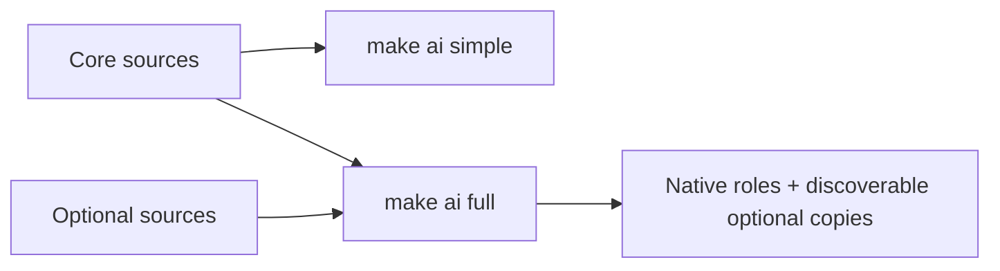

# Shared agent environment

Start with [Caveman](skills/caveman/SKILL.md) and [project-flow](skills/project-flow/SKILL.md).
Brief planning and solo work are defaults. User instructions and existing authorization
control scope. No skill, role or installer grants permission or installs other tools.

Before staging or composing commits, read [caveman-commit](skills/caveman-commit/SKILL.md).
It supplies Conventional Commits message rules in both modes. For an authorized
commit request, complete the commit; for a message-only request, return the message.

```sh
make ai          # show the two choices; installs nothing
make ai simple   # default: core skills, no native roles
make ai full     # opt-in: seven native roles and optional procedures
make ai-test     # standard-library environment tests only
```

No app dependencies, hooks, global settings or provider calls are part of installation.
Read the selected host's STARTUP.md if present; a bare checkout defaults to simple.

| Capability | Simple | Full |
| --- | --- | --- |
| Caveman + caveman-commit + project-flow | Yes | Yes |
| Brief planning, solo execution | Default | Default |
| Seven native roles | No | Available when useful |
| Council, Herdr, Cavecrew, SpecsMD | Not discovered | Available; use only when useful and authorized |
| Humanizer | Not discovered | Explicitly selected prose editing only |

```text
.agents/
  README.md
  agents/          seven role definitions, used by full
  skills/          caveman/, caveman-commit/, project-flow/, project how-tos
  optional/        council/, herdr/, cavecrew/, humanizer/, specsmd/, provenance
  rules/           project safety and development rules
  workflows/       optional procedures and existing project workflows
  tools/           capability guides; never auto-install plugins
  guardrails/      optional, uninstalled hooks; app checks opt-in
  adapters/        standard-library installer + adapter tests
  tests/           temp-fixture install/transition and guardrail tests
```



Codex and Gemini discover `.agents/skills` directly. Optional sources therefore live
under `optional/`; full installs owned copies into `.agents/skills/<name>/` and Claude's
`.claude/skills/`. Simple removes only owned generated copies. These shared discovery
files remain while any installed host still requests full; `make ai simple` switches
all three hosts together. Unmanaged files and settings are preserved; collisions fail.

See [adapters](adapters/README.md), [rules](rules/README.md), [workflows](workflows/README.md),
[tools](tools/README.md), and [provenance](optional/PROVENANCE.md). Optional source directories are
not a claim that a host registers their skills before full installation.
