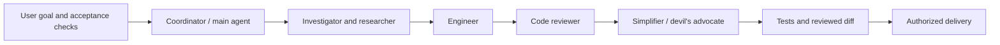

# Agentic setup

**My working environment for building with coding agents.**

By [Yehor Trepalin](https://github.com/yo1am1).

I assembled the main setup in at most one day. The skills and additions were
carefully selected and merged by me over time. This repository brings that
curation together: reusable instructions, specialist roles, host adapters,
optional planning tools, and checks that keep changes reviewable.

The engineering work here is in how the pieces fit: agents receive a clear scope,
independent work can run in parallel, integration stays accountable, and generated
configuration can be changed or removed without overwriting personal files.

## Try it

Python 3 and Git are enough for the installer and its environment tests.
From a fresh clone:

```sh
make ai          # inspect the two modes; installs nothing
make ai full     # generate the full setup for Claude Code, Codex and Gemini
make ai-test     # run 38 isolated adapter, installation and guardrail tests
```

For everyday focused work, `make ai simple` keeps three core skills and removes
only installer-owned optional skills and roles. Simple is the default when no
mode is selected. Full makes the specialist procedures available; the agent picks
what the task needs. Existing personal settings and unmanaged files are preserved.

For all repository checks, including source integrity:

```sh
uv sync --locked
make check
```

[Walk through the demo](docs/demo.md) · [How I built it](docs/setup-story.md) ·
[Validation](VALIDATION.md) · [Sources and licenses](PROVENANCE.md)

## A task can use the whole environment



Roles are selected per task. Small changes stay solo. For independent work,
assign separate paths and worktrees, agree the shared contracts, then review and
integrate the results. A worker's passing tests do not prove the combined change
passes. The [team workflow](.agents/workflows/team.md) defines that handoff.

| Role | Responsibility |
| --- | --- |
| Coordinator | Scope, dependencies, integration and final result |
| Researcher | Check uncertain claims and retain source evidence |
| Investigator | Trace the existing implementation and failure path |
| Engineer | Make the smallest complete implementation |
| Code reviewer | Find concrete correctness, safety and compatibility defects |
| Devil's advocate | Challenge consequential assumptions |
| Simplifier | Remove demonstrated complexity without losing behavior |

## What is included

- **Three host adapters:** Claude Code, Codex and Gemini. The same canonical
  instructions generate each host's native role format.
- **Core workflow:** Caveman, caveman-commit and project-flow. Brief planning,
  exact evidence, explicit ownership and small complete changes.
- **Optional procedures:** Council, Herdr, Cavecrew, Humanizer and the complete
  bundled Specs.md flows. Each keeps its own runtime and activation requirements.
- **Safe installation:** owned-file manifests, idempotent mode switches,
  collision detection, symlink/path checks, and preservation of unmanaged settings.
- **Optional Git guardrails:** checks against an isolated staged or outgoing Git
  snapshot. Hooks start uninstalled; project checks start empty.
- **A preserved reference library:** [library/](library/README.md) retains the
  earlier backend rules, engineering prompts, Ponytail skills and adapter generator.
  The root `.agents/` directory is the main environment.

## What the tests establish

The 38 environment tests exercise all three primary host outputs, simple/full
transitions, shared ownership, linked resources, unmanaged-file preservation,
unsafe-path refusal, partial staging and outgoing-ref validation. Tests use
throwaway repositories and home directories. Root checks also verify skill
metadata, every recorded source hash, and Python syntax.

Native files being generated does not prove that a real host launched a team.
The demo separates repeatable local checks from live agent execution. No provider,
account, global hook or paid integration is installed by the setup commands.

The [provenance](PROVENANCE.md) identifies adapted and third-party material.
This is a curated environment; upstream skills remain attributed to their authors.
